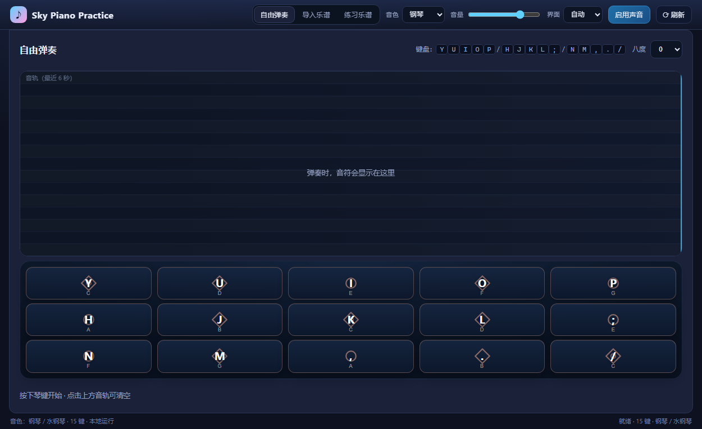
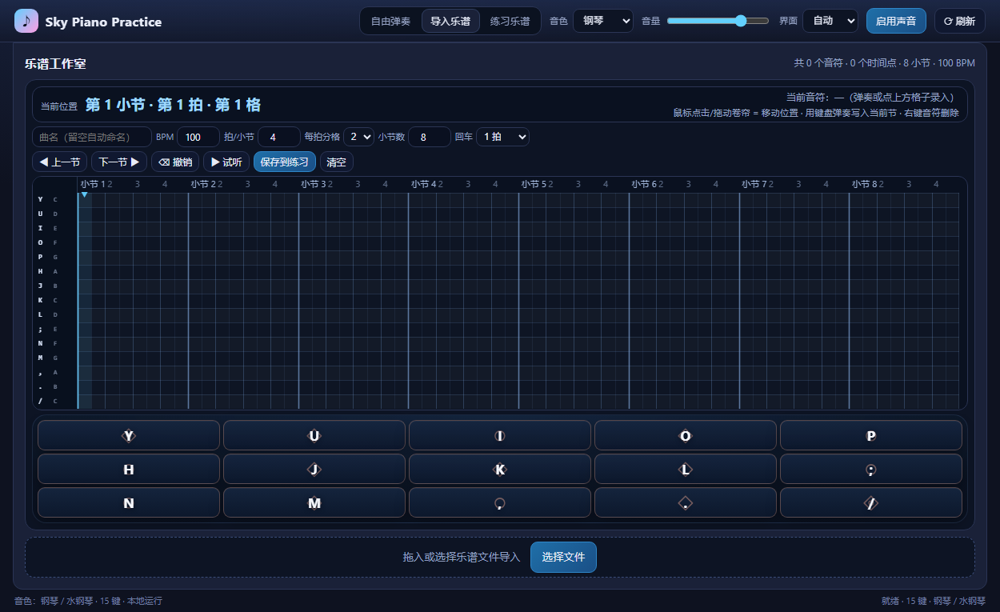
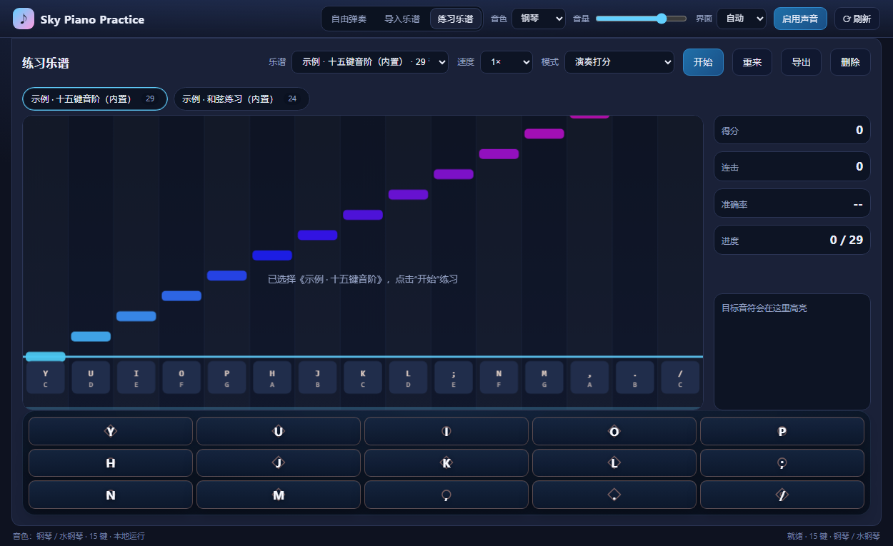
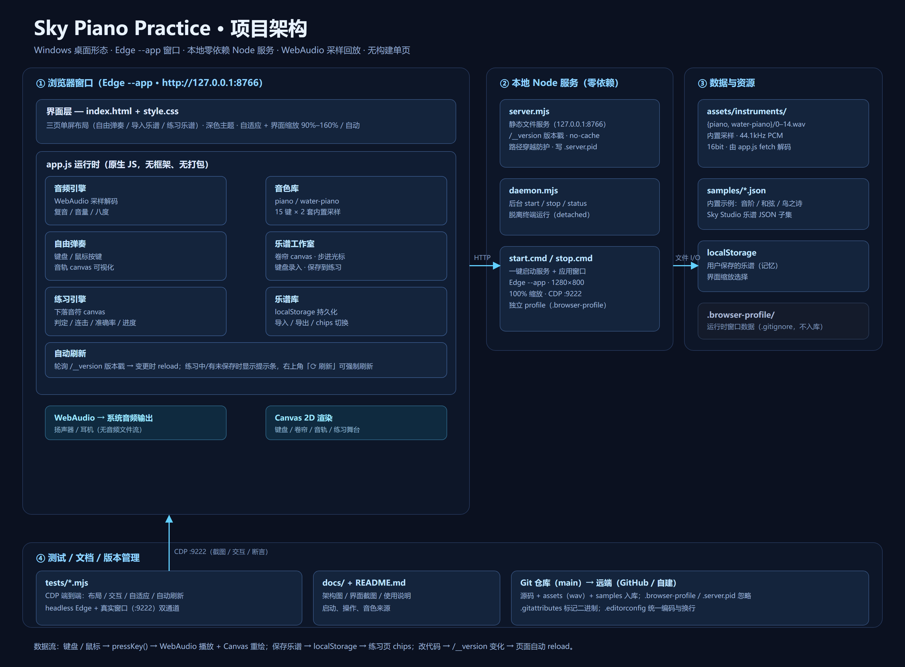

# Sky Piano Practice PC · 天空钢琴练习器

一款 **网页版钢琴练习器**：15 键键盘，支持 **自由弹奏 / 乐谱编辑 / 练习打分**。
纯前端实现，本地零依赖运行，用 Edge / Chrome 的应用窗口打开，像一个独立桌面应用。



## 功能

- **自由弹奏**：15 键映射，钢琴 / 水钢琴两套音色，复音，±2 八度切换，实时音轨可视化（最近 6 秒，点击清空）
- **乐谱工作室**：钢琴卷帘 + 步进光标 + 键位录入；鼠标点击/拖动只移动位置，弹奏写入当前小节；支持叠和弦、按 1 格 / 1 拍 / 1 小节步进（`Enter`）、撤销（`Backspace`）、右键删除音符、试听、保存
- **练习乐谱**：演奏打分（完美 ±80ms / 良好 ±160ms / 偏差）、连击、准确率、进度；跟弹模式（按对才继续）、自动示范；速度 0.5×–1.5×
- **乐谱库**：导入 / 导出 Sky Studio JSON，localStorage 持久化，练习页顶部 chips 直接切换
- **界面自适应**：三页单屏布局；窗口尺寸自适应；「界面」缩放 90%–160% 或自动，选择会记住
- **自动刷新**：本地开发时修改代码，页面自动更新；也可点右上角 `⟳ 刷新`





## 快速开始

```bash
# Windows（Node.js 18+）
start.cmd        # 启动本地服务（127.0.0.1:8766）+ 应用窗口
stop.cmd         # 停止服务（关闭窗口后服务仍在）
start.cmd 9000   # 指定端口
```

也可以手动运行：

```bash
node server.mjs 8766     # 只启动静态服务，浏览器打开 http://127.0.0.1:8766/
node daemon.mjs start    # 后台启动（stop / status 同理）
```

## 键盘映射

| 屏幕排 | 电脑按键 | 音名 | 键序号 |
| --- | --- | --- | --- |
| 上排 | `Y` `U` `I` `O` `P` | C D E F G | 0–4 |
| 中排 | `H` `J` `K` `L` `;` | A B C D E | 5–9 |
| 下排 | `N` `M` `,` `.` `/` | F G A B C | 10–14 |

15 键为 C 大调跨两个八度的音阶；鼠标点击琴键也可弹奏；「八度」下拉整体 ±2。

## 乐谱格式

兼容 Sky Studio / SkyMusic 导出的 JSON（`.json` / `.txt` / `.skysheet`）：

```json
{
  "name": "曲名",
  "author": "作者",
  "bpm": 120,
  "bitsPerPage": 16,
  "pitchLevel": 0,
  "songNotes": [
    { "key": "1Key0", "time": 0 },
    { "key": "2Key4", "time": 500 }
  ]
}
```

- `key`：`1Key0`–`3Key14` 或 `Key0`–`Key14`，数字部分为键序号 0–14
- `time`：毫秒（允许字符串数字）
- 也接受顶层为数组的格式（取第一个元素）
- `samples/` 内置示例：`twinkle.json`、`ode-to-joy.json`、`bird-poem.json`

## 项目结构

```
skystudio-pc/
├─ index.html            页面结构（三页单屏）
├─ style.css             深色主题 / 自适应 / 界面缩放
├─ app.js                运行时逻辑（音频、弹奏、工作室、练习、音轨、自动刷新）
├─ server.mjs            零依赖静态服务器 + /__version 版本戳
├─ daemon.mjs            后台启动 / 停止 / 状态
├─ start.cmd / stop.cmd  Windows 启停入口
├─ samples/              内置示例乐谱（Sky Studio JSON）
├─ assets/instruments/   piano/ 与 water-piano/ 各 15 个 wav 采样
├─ tests/                CDP 端到端测试（布局 / 交互 / 自适应 / 自动刷新）
├─ docs/                 架构图与截图
├─ .gitignore / .gitattributes / .editorconfig
├─ LICENSE
└─ README.md
```

## 架构



- **浏览器窗口**（Edge `--app`）：`index.html` + `style.css` 布局与主题；`app.js` 单文件运行时，包含音频引擎、音色库、自由弹奏、乐谱工作室、练习引擎、乐谱库、自动刷新七个模块；Canvas 2D 渲染，WebAudio 发声。
- **本地 Node 服务**（零依赖）：`server.mjs` 提供静态文件与 `/__version`；`daemon.mjs` 管理后台进程；`start.cmd` / `stop.cmd` 负责启动服务与应用窗口（100% 缩放、独立 profile、CDP 调试端口 9222）。
- **数据与资源**：`assets/instruments/` 内置采样（44.1kHz PCM 16bit）；`samples/*.json` 示例；用户乐谱与界面缩放存 `localStorage`。
- **数据流**：键盘/鼠标 → `pressKey()` → WebAudio 播放 + Canvas 重绘；保存 → `localStorage` → 练习页；源码变更 → `/__version` 变化 → 页面自动 reload。

## 测试

```bash
node tests/layout3.mjs     # 布局 / 交互 / 鼠标只移动位置
node tests/scale.mjs       # 界面缩放与自适应
node tests/live-shot.mjs   # 连接真实窗口 CDP（:9222）截图与指标
```

基于 headless Edge + CDP，覆盖三页单屏无溢出、缩放、键盘录入、右键删除、自动刷新等。

## v1.0

- 版本：`1.0.0`（tag `v1.0.0`）
- 变更记录见 [CHANGELOG.md](CHANGELOG.md)

## 兼容性与音色说明

- 乐谱格式兼容 Sky Studio / SkyMusic 导出的 JSON；本项目为独立实现，与上述应用无关联。
- `assets/instruments/` 中的钢琴 / 水钢琴采样仅用于个人学习与研究；相关音色版权归原权利人所有。如需商业使用，请替换为你拥有授权的采样。
- 代码采用 MIT License（见 [LICENSE](LICENSE)），不覆盖 `assets/` 下的音频素材。
